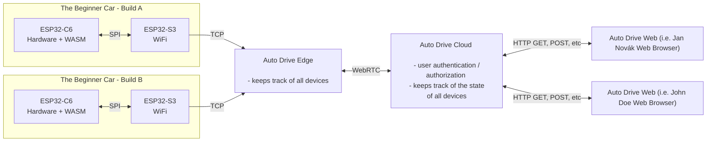

# AutoDrive
AutoDrive - Be the quickest. Think you can code? Prove it.

CURRENT CHALLENGE: Get the car from START to FINISH as quick as possible.

## What is AutoDrive?

A platform to run code on devices in our lab. After compiling your code (compiled down to WASM), you upload the code to our servers and we run it physically in the lab. An oppurtunity to test your coding skills and see it live without ANY shortcuts (well you can always try...)

## Architecture overview.

## Device Dashboards (Grafana)

- Auto Drive Cloud: [Dashboard](https://hugostechlab.grafana.net/public-dashboards/b4c0f91dc8ec4d2099b0f5fb6ae3dfbf)
- Auto Drive Edge (Alfa Passage): [Dashboard](https://hugostechlab.grafana.net/public-dashboards/b7b87c8a911646a5a6e3b43131fd4948)
- Raspberry Pi Model 4 B (Alfa Passage): [Dashboard](https://hugostechlab.grafana.net/public-dashboards/a73314b0452c47aba81d361d63200018)
- The Beginner Car (Alfa Passage): [Dashboard](https://hugostechlab.grafana.net/public-dashboards/d65b25969dcf46c1b631ac4f41bea44a)
